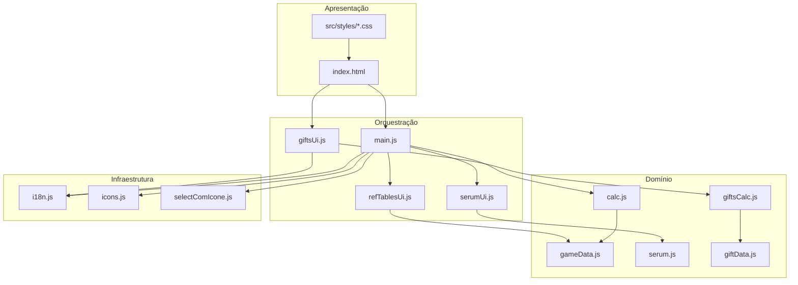

# Arquitetura

## Visão geral

Aplicação **SPA estática** empacotada com [Vite](https://vite.dev/). Não há backend: toda a lógica roda no navegador. O HTML define a estrutura das três ferramentas; o JavaScript liga eventos, persiste preferências e renderiza tabelas dinâmicas.

## Camadas

### 1. Dados (`gameData.js`, `giftData.js`, `serum.js`)

Objetos imutáveis com tabelas do jogo. Não acessam o DOM. Alterações aqui exigem validação manual contra a wiki/planilha de referência.

### 2. Lógica (`calc.js`, `giftsCalc.js`)

Funções puras (ou quase puras) que validam entradas e retornam resultados estruturados (`{ ok: true, … }` ou `{ ok: false, code: '…' }`).

### 3. UI (`main.js`, `*Ui.js`, `selectComIcone.js`)

- Lê valores dos controles.
- Chama a camada de lógica.
- Atualiza DOM (textos, tabelas, classes de erro).
- Salva/restaura `localStorage`.

### 4. i18n (`i18n.js`, `locales/*.json`)

Chaves de tradução aplicadas via `data-i18n` no HTML e via `t('chave')` no JS. Formatação numérica com `toLocaleString`.

## Fluxo — aba Custo (modo Objetivo)

1. Usuário altera reinício/nível ou raridade.
2. `main.js` chama `calcular_resultado()` com os quatro valores + raridade.
3. `calc.js` valida (`validar_entrada`) e calcula totais acumulados desde o início do progresso.
4. Diferença entre “desejado” e “atual” vira **Alma/Créditos restantes**.
5. `main.js` preenche `[data-result="…"]` e habilita “Copiar resultado”.

## Fluxo — aba Custo (modo Orçamento)

1. Usuário informa MP (Alma), opcionalmente Créditos, e ponto inicial (R/L).
2. `simular_progresso_alma()` avança nível a nível até faltar recurso ou atingir limite de reinício.
3. Retorna `linhas[]` com gasto/sobra por passo e posição final.
4. `main.js` monta resumo + tabela HTML e atualiza o guia lateral de reinícios.

## Fluxo — aba Presentes

1. Estado em `localStorage` (`presentes_estado_v1`): inventário 3×3×tiers e pontos por mercenária.
2. `giftsCalc.enriquecerLinha()` calcula RP favorito, total e faltante até 35.100.
3. `giftsUi.js` renderiza grids e tabelas; sub-abas “Calculadora” e “Favoritos”.

## Tema e layout

| Arquivo | Responsabilidade |
|---------|------------------|
| `tokens.css` | Variáveis CSS (`--cor-*`, espaçamentos); overrides em `.tema_escuro` |
| `layout.css` | Reset, `.app`, grid do workspace, media queries estruturais |
| `components.css` | Componentes visuais (cards, tabelas, abas, presentes, orçamento) |

A classe `tema_escuro` no `<html>` alterna o conjunto de tokens. Na primeira visita, `prefers-color-scheme` define o tema se não houver valor salvo.

## Build Vite

- `base: './'` em `vite.config.js` — caminhos relativos para GitHub Pages ou subpastas.
- `public/` copiado para a raiz do `dist/`.
- Módulos JS bundlados; CSS importado pelo HTML (não pelo JS).

## Versão legada

`legacy/calculadora_alma_creditos_lust_goddess.html` — implementação monolítica anterior, mantida como referência histórica. A versão atual modulariza dados e UI.
