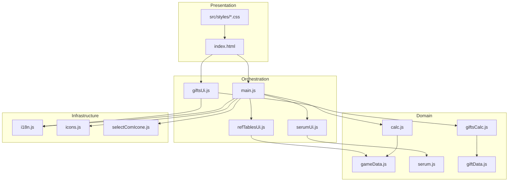

# Architecture

## Overview

**Static SPA** bundled with [Vite](https://vite.dev/). No backend: all logic runs in the browser. HTML defines the structure of the three tools; JavaScript wires events, persists preferences, and renders dynamic tables.

## Layers

### 1. Data (`gameData.js`, `giftData.js`, `serum.js`)

Immutable objects with game tables. No DOM access. Changes here should be validated against wiki/reference spreadsheets.

### 2. Logic (`calc.js`, `giftsCalc.js`)

Mostly pure functions that validate input and return structured results (`{ ok: true, … }` or `{ ok: false, code: '…' }`).

### 3. UI (`main.js`, `*Ui.js`, `selectComIcone.js`)

- Reads control values.
- Calls the logic layer.
- Updates the DOM (text, tables, error classes).
- Saves/restores `localStorage`.

### 4. i18n (`i18n.js`, `locales/*.json`)

Translation keys applied via `data-i18n` in HTML and `t('key')` in JS. Number formatting via `toLocaleString`.

## Flow — Cost tab (Goal mode)

1. User changes restart/level or rarity.
2. `main.js` calls `calcular_resultado()` with four values + rarity.
3. `calc.js` validates (`validar_entrada`) and computes totals accumulated from progress start.
4. Difference between “desired” and “current” becomes **remaining Soul/Credits**.
5. `main.js` fills `[data-result="…"]` and enables “Copy result”.

## Flow — Cost tab (Budget mode)

1. User enters MP (Soul), optional Credits, and start point (R/L).
2. `simular_progresso_alma()` advances level by level until resources run out or restart limit is hit.
3. Returns `linhas[]` with spend/leftover per step and final position.
4. `main.js` builds summary + HTML table and updates the side restart guide.

## Flow — Gifts tab

1. State in `localStorage` (`presentes_estado_v1`): 3×3×tier inventory and points per mercenary.
2. `giftsCalc.enriquecerLinha()` computes favorite RP, total, and remaining to 35,100.
3. `giftsUi.js` renders grids and tables; sub-tabs “Calculator” and “Favorites”.

## Theme and layout

| File | Responsibility |
|------|----------------|
| `tokens.css` | CSS variables (`--cor-*`, spacing); overrides in `.tema_escuro` |
| `layout.css` | Reset, `.app`, workspace grid, structural media queries |
| `components.css` | Visual components (cards, tables, tabs, gifts, budget) |

The `tema_escuro` class on `<html>` switches token sets. On first visit, `prefers-color-scheme` sets the theme if nothing is stored.

## Vite build

- `base: './'` in `vite.config.js` — relative paths for GitHub Pages or subfolders.
- `public/` copied to the root of `dist/`.
- JS modules bundled; CSS linked from HTML (not imported by JS).

## Legacy version

`legacy/calculadora_alma_creditos_lust_goddess.html` — earlier monolithic implementation, kept for reference. The current version splits data and UI into modules.
